<div align="center">

# 📖 论文带读 PDF 生成器

**Paper Reading Guide Skill**

*丢进一篇论文 PDF，产出一本零基础也能读懂的完整中文精读手册*

[](./LICENSE)
[](https://tug.org/texlive/)
[](https://claude.ai/code)
[](#-设计哲学)
[](#-内容质量红线)

<br>

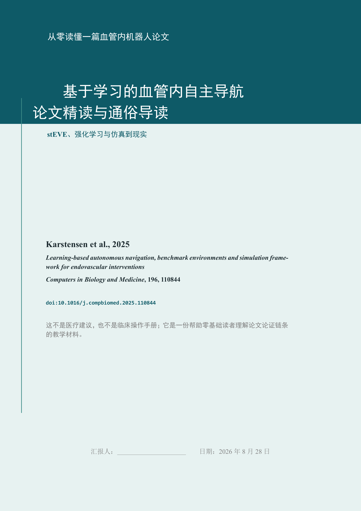

<sub>▲ 由本 Skill 生成的实际交付物封面（44 页 / A4 / XeLaTeX 排版）</sub>

<br>

[特性](#-核心特性) · [效果展示](#-效果展示) · [快速开始](#-快速开始) · [工作流](#-工作流) · [设计系统](#-视觉设计系统) · [陷阱清单](#-陷阱清单) · [FAQ](#-常见问题)

</div>

---

## 💡 这是什么

一句话：**把一篇英文论文，翻译成一本「零基础也能从头读到尾」的中文精读手册。**

学术论文对新手并不友好——术语密集、图表信息嵌套、公式跳步、结论边界含糊。大多数人第一次读论文时都会掉进两个陷阱：要么从摘要逐字啃、遇到术语就卡住；要么直接翻到结果，却不知道那些数字在什么前提下才成立。

本 Skill 的解法不是"给个摘要"，而是**按论文自身的写作顺序，重写一本带读手册**：

- 摘要、引言、方法、结果、讨论——**逐句/逐段精读**，给出英文原文 → 中文翻译 → 讲解；
- **每一个图、每一张表都紧跟"逐项带读"**：图中每个英文标签逐个中英互译，说明颜色/符号/箭头的含义；
- 专业术语首次出现即给"大白话"，文末附**双语术语表**；
- 明确划出**"这张图能证明什么" vs "不能证明什么"**；
- 关键结论给**常见误读纠偏**，防止把"仿真成功率"读成"临床成功率"。

它不预设任何特定论文、学科或格式。

---

## ✨ 核心特性

<table>
<tr>
<td width="50%" valign="top">

### 🎯 逐图逐表带读
每个图下方**紧跟**带读小节，不跨页分离：整体阅读顺序 → 图中每个英文标签的中英互译表 → 颜色/符号/箭头含义 → 能证明什么 / 不能证明什么 → 对应论文正文位置与代码位置。

</td>
<td width="50%" valign="top">

### 🗣️ 真正的零基础
不假设读者有该领域背景。每个专业词首次出现配"大白话"框；需要前置知识时（强化学习、统计、信号、物理……）插入一章"最小必要入门"。

</td>
</tr>
<tr>
<td width="50%" valign="top">

### 🧩 泛化性设计
Skill 内**不含任何单篇论文的专属信息**。所有章节都是"角色模板" + `[占位符]`，每次使用都从输入 PDF 重新提取内容，避免复用时的信息污染。

</td>
<td width="50%" valign="top">

### 🔍 数字与边界透明
摘要里的 "up to / 最高达" 是宣传性概括 → 精确数字回正文表格逐格核对；每个指标的统计对象（全体/失败子集/成功子集）与分母都写清楚。

</td>
</tr>
<tr>
<td width="50%" valign="top">

### 📐 出版级排版
统一主题色板 + 自定版式组件（路线/大白话/定义/误读警示/阅读要点）；正文连续流动，**无强制分页、无空白页、无表格越界**。

</td>
<td width="50%" valign="top">

### 📦 可复现源码包
除编译好的 PDF 外，同时输出完整 LaTeX 工程（含裁图脚本、裁剪坐标、`latexmkrc`），任何人可一键重编。

</td>
</tr>
</table>

---

## 🎬 效果展示

> 以下全部截图来自 `example/` 中的真实运行结果：
> 输入 `example/paper_example.pdf`（15 页，英文期刊论文）→ 输出 `example/result_example.pdf`（**44 页**中文精读手册）。

### 📄 输入 → 输出

<table>
<tr>
<td width="50%" align="center">
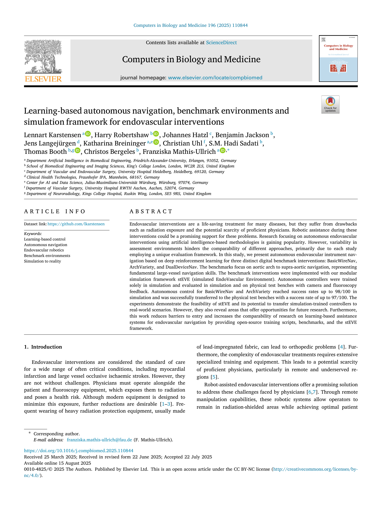
<br><sub><b>输入</b>：15 页英文论文 PDF<br>（Karstensen et al., <i>Comput. Biol. Med.</i> 196 (2025) 110844）</sub>
</td>
<td width="50%" align="center">

<br><sub><b>输出</b>：44 页中文带读手册<br>含封面、术语表、公式速查、FAQ、代码带读</sub>
</td>
</tr>
</table>

---

### 1️⃣ 阅读地图：三分钟建立全局观

开篇不急着细读，而是先给一张"地图"：**论证链**（痛点 → 方案 → 验证 → 洞见）、**日常类比表**、**"做了什么 / 没做什么"双栏卡片**、**分读者阅读建议**、**章节-论文结构对照表**。

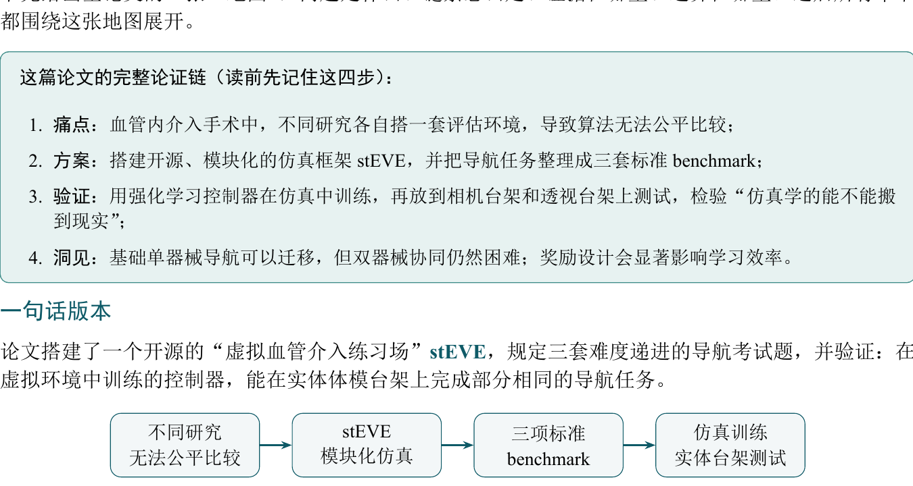

论文的四个步骤被翻译成驾校类比：不同研究各自搭评估环境 → 成绩无法横向比较；建统一仿真框架 → 公布统一考试路线；仿真训练后上台架测试 → 模拟器学完上封闭赛道；基础单器械可迁移但双器械协同仍难 → 普通路况能开、双人协同还不行。

用**双栏卡片**把"论文做了什么 / 没有做什么"并列摆出，从一开始就把预期钉死：

<table>
<tr>
<td width="50%" align="center">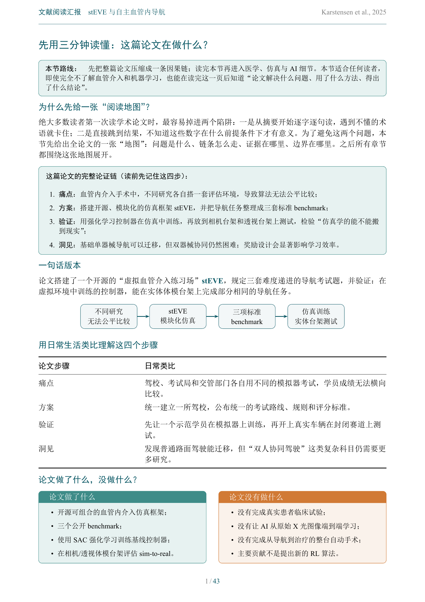</td>
<td width="50%" align="center">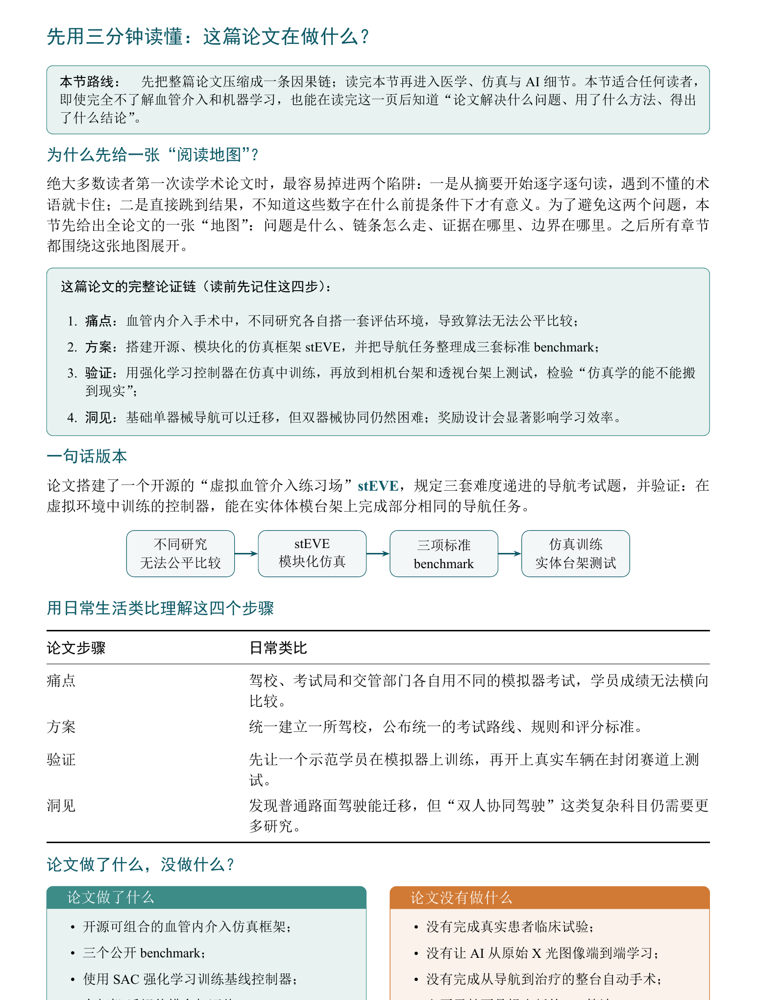</td>
</tr>
<tr>
<td align="center"><sub>整页效果（论证链 + 类比表 + 双栏卡片）</sub></td>
<td align="center"><sub>细节：分读者阅读建议 + 章节对照表</sub></td>
</tr>
</table>

---

### 2️⃣ 逐图逐表带读：本 Skill 的核心特色

这是最能体现"不是摘要、而是真带读"的部分。**论文原图**下方紧跟一段"逐项带读"。

#### 🔹 Figure 1 — 框架总览图

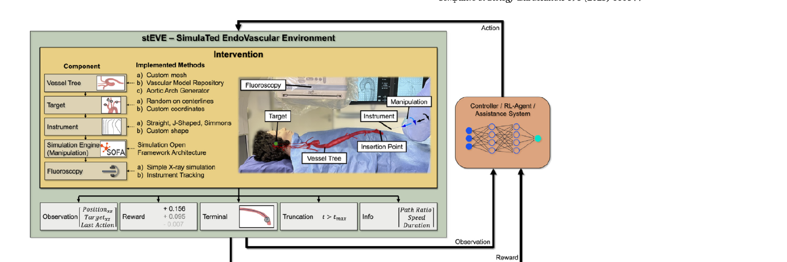

图下方立刻回答"这张图怎么读"：整体阅读顺序（左→中→底→右）、五类 Component 组件逐个中英互译、每个图标代表什么、底部五类反馈项、外围黑箭头的闭环含义——**每一项都标出对应的论文位置与代码路径**：

<table>
<tr>
<td width="58%" align="center">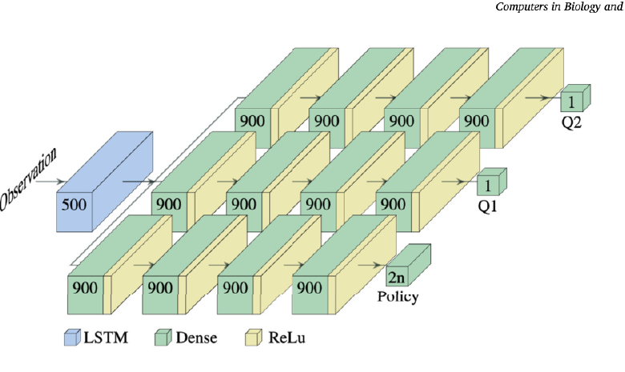</td>
<td width="42%" align="center">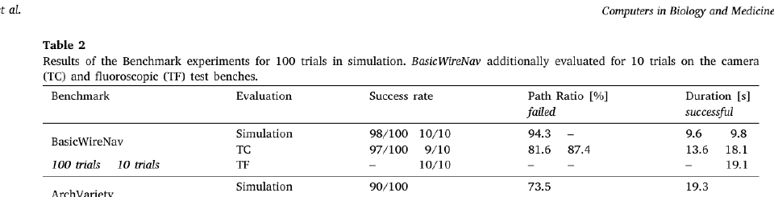</td>
</tr>
<tr>
<td align="center"><sub><b>Figure 3</b>：SAC 控制器网络结构 —— 逐层翻译 500 / 900 / 1 / 2n 到底指什么</sub></td>
<td align="center"><sub><b>Table 2</b>：结果表 —— 每一列出处、分母、样本量逐字段核对</sub></td>
</tr>
</table>

#### 🔹 Figure 2 — 三个 benchmark 的血管几何

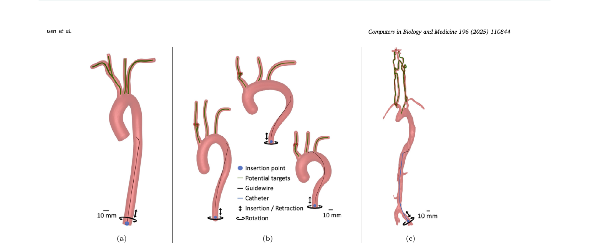

图例里的 `Insertion point` / `Potential targets` / `Guidewire` / `Catheter` / `Insertion ←→ Retraction` / `Rotation` / `10 mm` 比例尺——每一个符号都被翻译并说明视觉含义，再逐一比较三幅子图的难度差异。

#### 🔹 Figure 4 — 实体台架实验

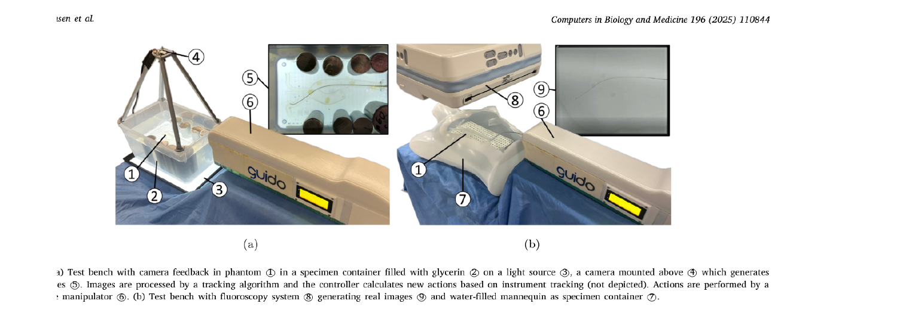

编号 ①–⑨ 逐个对应：① phantom 体模 ② glycerin 甘油 ③ light source 光源 ④ camera 相机 ⑤ real images 真实图像 ⑥ guidewire manipulator 导丝操纵器 ⑦ water-filled mannequin 注水人体模型 ⑧ fluoroscopy system 透视系统 ⑨ real images 透视图像。并同时给出**关键边界提醒**——图中 "real images" 指的是真实设备产生的图像，**不等于真实患者或临床可用**。

<table>
<tr>
<td width="50%" align="center">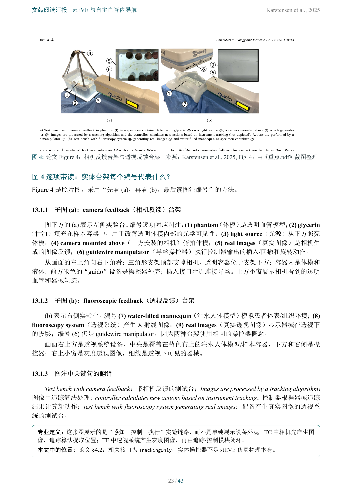</td>
<td width="50%" align="center"></td>
</tr>
<tr>
<td align="center"><sub>台架实验小节整页：实拍图 + 编号对应表 + 边界提醒</sub></td>
<td align="center"><sub>三个 benchmark 血管几何：图例符号逐个翻译</sub></td>
</tr>
</table>

#### 🔹 结果曲线图

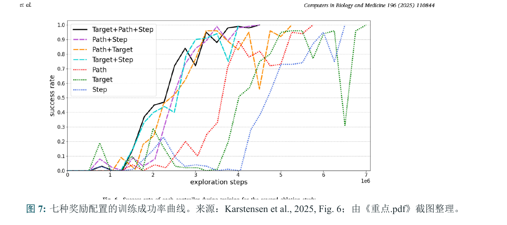

七种奖励配置的训练曲线：坐标轴逐项翻译、七条线型/颜色逐条对应、从下到上观察曲线的读法、以及"它能支持什么结论 / 不能支持什么结论"。

以下为**完整页面实拍**，可直接看出图文如何紧邻排布：

<table>
<tr>
<td width="50%" align="center">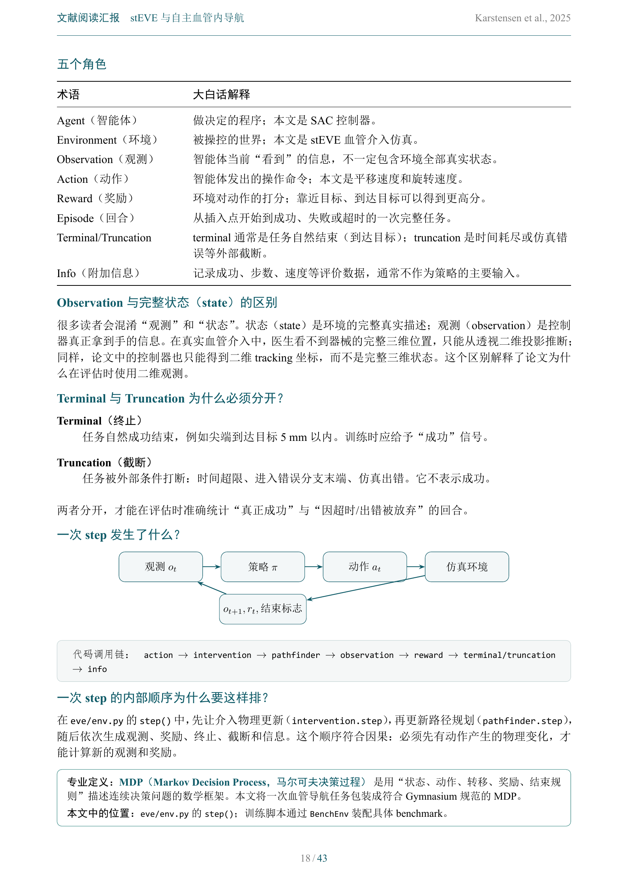</td>
<td width="50%" align="center">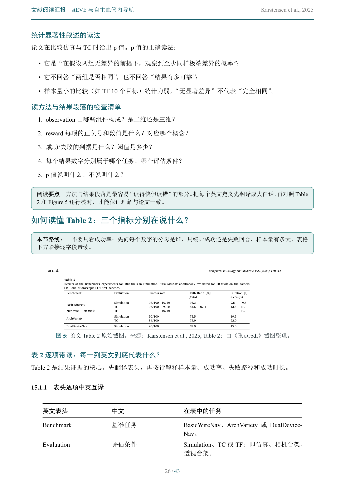</td>
</tr>
<tr>
<td align="center"><sub>MDP / episode 生命周期图解</sub></td>
<td align="center"><sub>Table 2 指称口径与统计提醒</sub></td>
</tr>
<tr>
<td width="50%" align="center">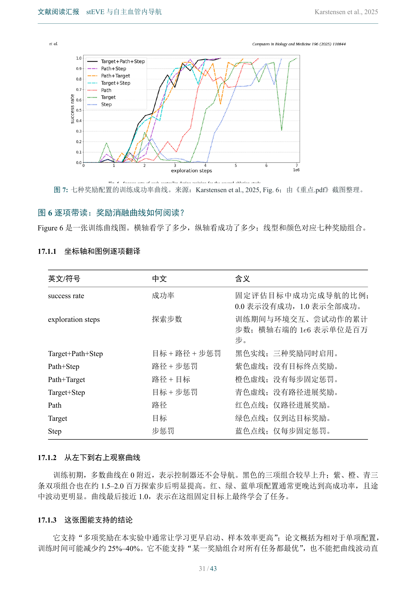</td>
<td width="50%" align="center">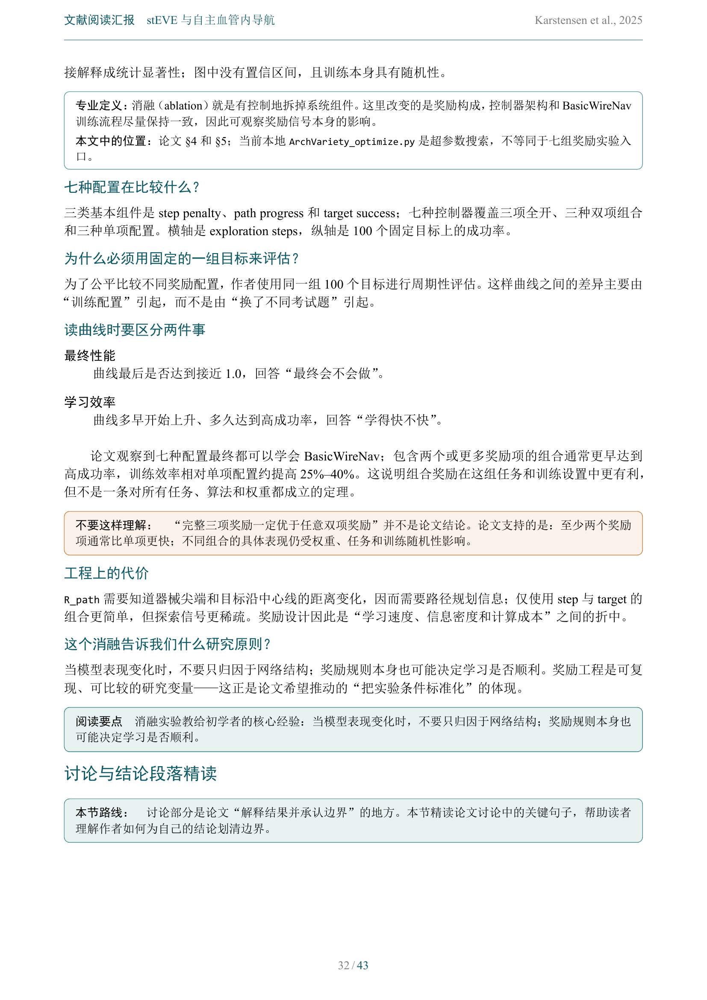</td>
</tr>
<tr>
<td align="center"><sub>消融实验设计与读法</sub></td>
<td align="center"><sub>误读纠偏与边界检查清单</sub></td>
</tr>
</table>

---

### 3️⃣ 排版组件：不是纯文字，而是"视觉化的讲解"

preamble 提供一整套语义化版式组件，让不同性质的内容在视觉上立刻可辨：

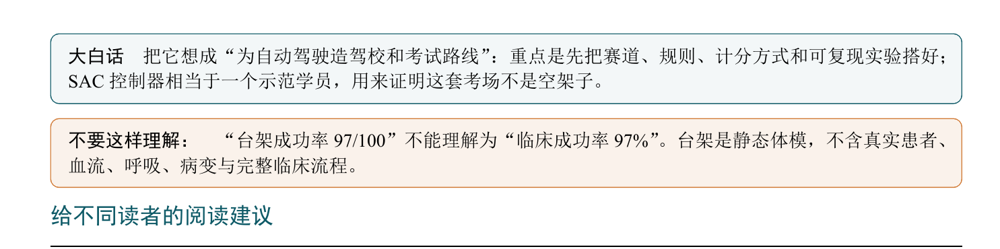

| 组件 | 语义 | 视觉 |
|---|---|---|
| `\roadmap{}` | 本节路线 | 浅青绿框 |
| `\plain{}` | 大白话 | 浅蓝框 |
| `\definition{}{}` | 专业定义 + 本文位置 | 白底青绿框 |
| `\warning{}` | 不要这样理解 | 暖橙警示框 |
| `\takeaway{}` | 阅读要点 | 青绿框 |
| `\noteBox{}` | 注意 | 白底暖橙框 |
| `\key{}` / `\highlight{}` | 关键词着色 / 强调 | 主题色 |

---

### 4️⃣ 附录三件套：术语表 · 公式速查 · FAQ

<table>
<tr>
<td width="33%" align="center">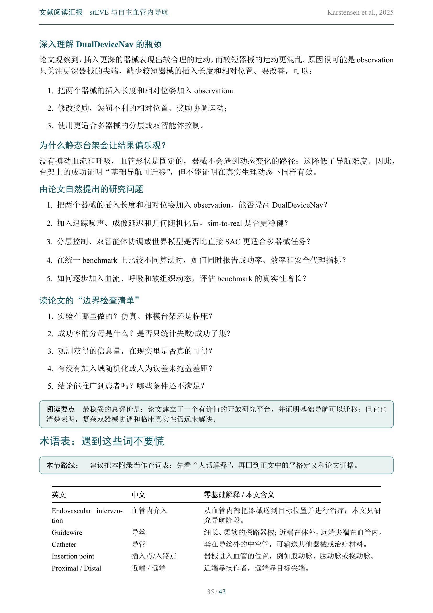</td>
<td width="33%" align="center">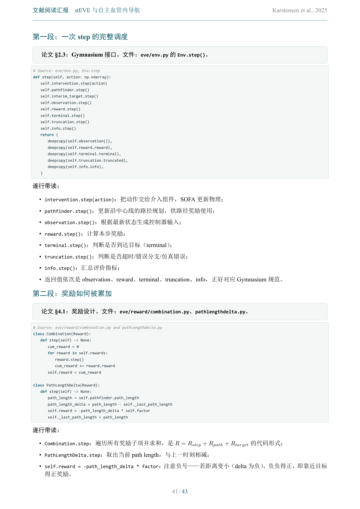</td>
<td width="33%" align="center">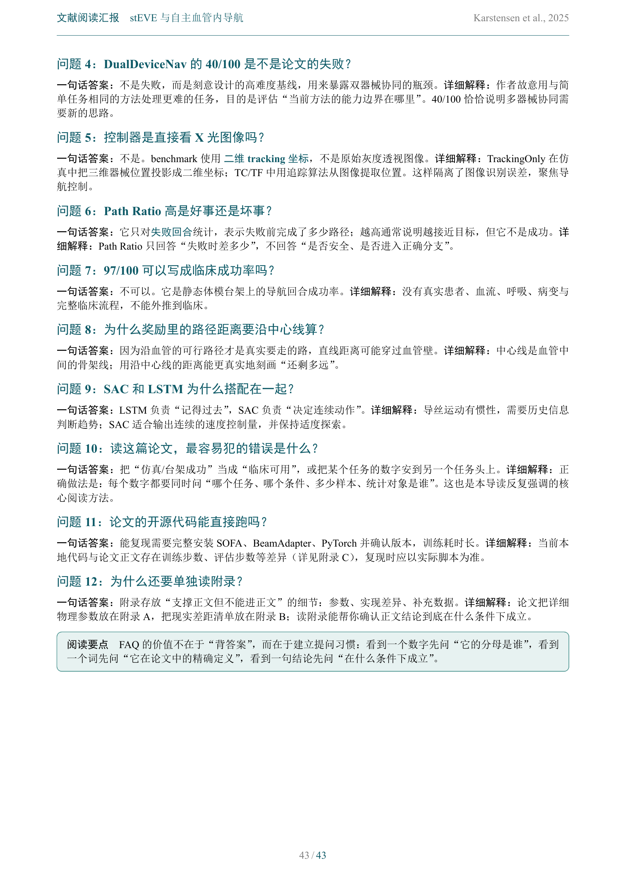</td>
</tr>
<tr>
<td align="center"><sub><b>术语表</b><br>英文 | 中文 | 零基础解释</sub></td>
<td align="center"><sub><b>源码逐行带读</b><br>论文概念 → 代码文件映射</sub></td>
<td align="center"><sub><b>FAQ</b><br>12+ 问，"一句话答案 + 详解"</sub></td>
</tr>
</table>

由于论文是开源的，手册额外包含**代码逐行带读**：展示最小代码快照，逐行说明它对应论文的哪个概念，并附"如果改这里会发生什么"表。

---

## 🚀 快速开始

### 环境要求

| 依赖 | 说明 |
|---|---|
| **TeX Live** | 需要 `xelatex`、`latexmk`（建议 v4.8x）、`pdftoppm`、`pdftocairo`、`pdfinfo`、`pdftotext` |
| **中文字体** | `ctexart` / `xeCJK` + 系统中文字体（Microsoft YaHei、SimSun、Noto Sans/Serif SC 均可） |
| **Python 3** | 可选，装 `Pillow` 用于裁图 |
| **LaTeX 宏包** | `geometry fontspec amsmath amssymb graphicx booktabs tabularx array multirow longtable makecell caption subcaption enumitem float listings tcolorbox tikz fancyhdr lastpage hyperref xcolor titlesec setspace ragged2e pifont` |

> ⚠️ **中文文档必须用 XeLaTeX 编译**，不要用 pdflatex。

### 安装为 Claude Code Skill（可选）

把本文件夹放进任意项目（或全局）的 skills 目录，即可被 `/` 斜杠命令发现：

```bash
# 项目级
cp -r paper-reading-guide-skill <你的项目>/.claude/skills/paper-reading-guide

# 全局（Linux / macOS）
cp -r paper-reading-guide-skill ~/.claude/skills/paper-reading-guide

# 全局（Windows PowerShell）
Copy-Item -Recurse paper-reading-guide-skill $HOME\.claude\skills\paper-reading-guide
```

或在 Cherry Studio 的**「技能管理」**中导入 `SKILL.md`。

### 使用

```text
/paper-reading-guide <论文.pdf路径>
```

或直接用自然语言：

```text
用论文带读技能处理 ./my_paper.pdf
```

也可以让 Claude 读取 `SKILL.md` 后按其中流程执行。**每次使用都会从输入的 PDF 重新提取内容，不依赖、不预设任何单篇论文的信息。**

---

## 🔧 工作流


| 阶段 | 做什么 | 关键要点 |
|---|---|---|
| **0 · 定位读取** | 提取全文，建立"论文信息卡" | PDF 加密时改用 `pdftotext` + `pdftoppm` 渲染页 + 视觉读取，**不要放弃** |
| **1 · 素材准备** | 裁出引用的图/表 | 双栏/双语并排版式只取主文半页，避免同图重复；命名 `fig01_*.png` / `tab02_*.png` |
| **2 · 建立工程** | 生成 LaTeX 工程骨架 | 直接复用 `references/preamble.tex`；目录建议 ASCII 命名 |
| **3 · 撰写正文** | 按论文写作顺序成文 | 25 个"章节角色模板"，用真实内容替换 `[占位符]`；**不要用 `\clearpage`** |
| **4 · 逐图带读** | 图片下方紧跟带读小节 | 见下方规范 |
| **5 · 编译** | `latexmk` 多轮编译 | `latexmk -xelatex -outdir=build -jobname=<name> -interaction=nonstopmode -file-line-error main.tex` |
| **6 · 验收修复** | 渲染预览 + 逐页检查 | `Overfull` 必须清到 0；`pdftotext` 校验章节齐全 |

### 逐图带读规范（阶段 4）

每个 Figure / Table 图片下方**紧跟**（不跨页分离）一个小节，固定包含：

1. **整体阅读顺序** —— 例如"先看左列 → 中央 → 底部 → 右侧"；
2. **图中每一个英文标签的中英互译表** —— 英文 | 中文 | 含义/代码对应；
3. **颜色、符号、箭头、数字、子图编号的含义**；
4. **"这张图能证明什么" vs "不能证明什么"** —— 后者用 `\warning`；
5. **对应论文正文位置或代码位置** —— 用 `\definition` 的第二个参数。

### 章节角色模板（25 章）

正文严格按论文写作顺序组织：

```text
00 封面                01 阅读地图             02 摘要逐句精读
03 引言逐段精读         04 研究动机             05 相关背景知识精读
06 方法/框架总览 + 图带读 07 核心技术概念精讲    08 实验任务/基准设计 + 图带读
09 任务/参数精读        10 方法入门             11 核心算法/模型 + 图带读
12 关键公式与设计精讲    13 实验设计与评估方式    14 方法与结果段落精读
15 结果与指标解读 + 表带读 16 结果分析 + 图带读   17 消融/对比实验 + 图带读
18 讨论与结论段落精读    19 局限与展望           20 术语表
21 公式与参数速查        22 论文—代码/复现索引   23 读论文检查表
24 代码阅读路径 + 逐行带读 25 常见问题 FAQ
```

> 若论文不含某角色（无开源代码、无消融实验），**跳过对应章节，不要硬凑**。

---

## 🎨 视觉设计系统

### 色板

| 角色 | 名称 | HEX |
|---|---|---|
| 主色 | DeepTeal 深蓝绿 | `#0E5A67` |
| 辅色 | MidTeal 青绿 | `#3E8C88` |
| 强调 | WarmOrange 暖橙 | `#D17A35` |
| 背景 | PaleBlue 浅灰蓝 | `#F3F7F8` |
| 背景 | PaleTeal 浅青绿 | `#E7F2F1` |
| 正文 | Ink 墨色 | `#1D2B30` |

### 字体与页式

- 正文西文 Times New Roman，中文宋体/黑体，代码 Consolas；
- 页眉左侧「文献阅读汇报 · `<论文主题>`」，右侧「`<作者>`, `<年>`」；
- 页脚页码 `当前 / 总页`。

### 输出工程结构

```text
<paper>_reading_report/
├── main.tex                # 主文档：\input preamble + 各 section
├── preamble.tex            # 统一主题（复用 references/preamble.tex）
├── references.bib
├── latexmkrc
├── README.md
├── sections/               # 各章正文（按论文写作顺序编号）
│   ├── 00_cover.tex
│   ├── 01_map.tex
│   └── ...
├── assets/
│   ├── figures/            # 裁好的论文图
│   ├── code/               # 最小代码快照
│   └── diagrams/           # 自绘 TikZ 图
├── scripts/
│   └── extract_paper_assets.py   # 裁图脚本（记录裁剪坐标）
├── build/                  # 编译输出
└── preview/                # 验收预览
```

### 交付物

1. 编译好的 PDF —— `build/<论文名>_reading_report.pdf`
2. 可复现源码包 —— `<论文名>_reading_report_source.zip`

---

## ⚠️ 陷阱清单

LaTeX 排版 + 论文处理中踩过的坑，全部记录在 `references/build-checklist.md`。摘录几条高频的：

| # | 陷阱 | 处理 |
|---|---|---|
| 1 | `\accent` 与 LaTeX 内置冲突 | 自定义强调命令命名 `\highlight` |
| 2 | Markdown 反引号混入 LaTeX → `Missing $` | 改用 `\texttt{}`，下划线写 `\_` |
| 3 | TikZ 节点换行用单个 `\` | **必须用 `\\`** |
| 4 | `#` 未转义 → `macro parameter character #` | 写成 `\#` |
| 5 | 带圈数字 ①②③ 字体缺失 | 改用 `(1)(2)(3)` |
| 6 | **表格越界**（曾出现数百 pt） | `tabularx` 混用 `p{}` + `Y` 会失控；改固定两列宽度之和 < 1.0 `\linewidth` |
| 7 | `\clearpage` 制造空白页 | 正文各章之间不要用，让内容连续流动 |
| 8 | PDF 密码保护导致提取失败 | 改用 `pdftotext` + `pdftoppm` + 视觉读取 |
| 9 | 后台 Bash 的 `cd` 不回传 | 写在同一命令里，或全程绝对路径 |
| 10 | 写死的章节号 | 重排后引用会错；用描述性名称或 `\ref` |

> 📌 验收标准：`rg -n "Overfull" build/<jobname>.log` 必须清到 0 或仅剩不可见的极小值。

---

## ✅ 内容质量红线

| 原则 | 含义 |
|---|---|
| **无删减、无精简** | 所有已写内容必须保留；合并/重排时把内容"迁入"而非"删除" |
| **零基础可读** | 每个专业词首次出现给"大白话"；术语表要全 |
| **图文对应** | 图的详细解释紧跟图片下方，不跨页分离 |
| **来源标注** | 论文截图图注标明来源；代码展示用于教学，**不冒充论文实验结果** |
| **不夸大** | 实验结果 ≠ 现实/临床可用；不重新训练、不伪造数据、不臆造论文没说的结论 |
| **版本差异透明** | 论文正文描述 vs 当前开源代码若不一致（参数、步数、时长等），单独成框说明 |
| **泛化性** | 不含任何单篇论文的专属信息，每次从输入 PDF 重新提取 |

---

## 📁 目录结构

```text
paper-reading-guide-skill/
├── SKILL.md                    # 技能主文件（完整工作流 + 章节模板 + 陷阱清单）
├── README.md                   # 本文件
├── assets/
│   └── readme/                 # 本 README 使用的效果截图
├── example/
│   ├── paper_example.pdf       # 示例输入：15 页英文论文
│   └── result_example.pdf      # 示例输出：44 页中文带读手册
└── references/
    ├── preamble.tex            # 可复用 LaTeX 主题模板（XeLaTeX + ctexart）
    ├── chapter-outline.md      # 通用章节角色模板（按论文写作顺序）
    └── build-checklist.md      # 构建/修复/验收清单 + 错误速查表
```

---

## ❓ 常见问题

<details>
<summary><b>支持哪些学科的论文？</b></summary>

任何学科。Skill 本身不含领域假设，所有章节都是角色模板。已在医学/机器人论文上验证，同样的流程适用于物理、信号、算法、系统、网络等方向。
</details>

<details>
<summary><b>会预设或复用某篇论文的信息吗？</b></summary>

不会。每次使用都从输入 PDF 重新提取内容。`references/` 里只有通用模板，没有任何单篇论文的术语名、数字或代码路径——这也是"泛化性"红线的要求。
</details>

<details>
<summary><b>论文没有开源代码怎么办？</b></summary>

跳过代码相关章节（22、24 章）。章节模板中明确写了："若论文不包含某角色，则跳过对应章节，不要硬凑。"
</details>

<details>
<summary><b>编译中文报错？</b></summary>

99% 是把 `xelatex` 写成了 `pdflatex`。中文文档**必须**用 XeLaTeX。
</details>

<details>
<summary><b>PDF 提取时报"密码保护"？</b></summary>

不要放弃，走降级路径：`pdftotext -enc UTF-8` 试提取 → 不行就用 `pdftoppm -png -r 150` 渲染每页 PNG，再用视觉能力读页。部分受保护 PDF 仍可正常渲染。
</details>

<details>
<summary><b>结果 PDF 里出现空白页或表格越界？</b></summary>

对照「陷阱清单」。空白页基本是 `\clearpage` 造成的；表格越界通常是 `tabularx` 里混用了固定宽列和 `Y` 列，改成固定两列宽度即可。
</details>

<details>
<summary><b>生成一份要多久？</b></summary>

取决于论文长度与图表数量。示例论文 15 页 → 44 页手册，属于中等规模。图表多、需要逐项带读的论文会更久。
</details>

---

## 🤝 贡献

欢迎提交 Issue 或 PR，特别是：

- 🐛 新的 LaTeX 排版陷阱与修复方案（请附最小复现）
- 📄 其他学科论文的成功案例（可放入 `example/`）
- 🎨 主题色板或版式组件的改进
- 📖 文档与翻译修正

## 📄 许可

本项目采用 MIT License。若你计划正式开源，请补充 `LICENSE` 文件与版权署名。

## 🙏 致谢

示例输出基于 Karstensen et al., *"Learning-based autonomous navigation, benchmark environments and simulation framework for endovascular interventions"*, **Computers in Biology and Medicine** 196 (2025) 110844 —— 感谢作者开源论文、代码与实验框架，使 sim-to-real 研究可被复现与教学。

---

<div align="center">
<sub>用论文自身的结构，讲成读者能听懂的语言。</sub>
</div>
